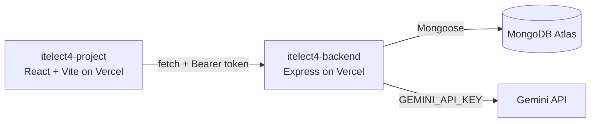

# itelect4-backend

[](https://github.com/amy9273/itelect4-backend/actions/workflows/ci.yml)

Backend REST API for ITELECT4 (Node.js, Express, TypeScript, MongoDB Atlas, and JWT authentication).

- **Live Backend API**: [https://itelect4-backend-rho.vercel.app/](https://itelect4-backend-rho.vercel.app/)
  - Health Check: [https://itelect4-backend-rho.vercel.app/api/health](https://itelect4-backend-rho.vercel.app/api/health)
- **Live Frontend App**: [https://itelect4-project-red.vercel.app/](https://itelect4-project-red.vercel.app/)
- **Frontend Repository**: [https://github.com/amy9273/itelect4-project](https://github.com/amy9273/itelect4-project)

## Architecture



## Environment Variables

Copy `.env.example` to `.env` and fill in your values:

```env
MONGODB_URI=mongodb+srv://<username>:<password>@<cluster>.mongodb.net/<database>?retryWrites=true&w=majority
JWT_SECRET=your-secret-key
PORT=4000
```

## Available Scripts

- `npm run dev`: Starts the development server with live reload via `tsx watch`
- `npm run build`: Compiles TypeScript to JavaScript in `dist/`
- `npm run start`: Runs compiled production code with `node dist/server.js`
- `npm run typecheck`: Runs TypeScript type check without emitting files (`tsc --noEmit`)

## API Endpoints

### Health Check
- `GET /api/health` -> `{ ok: true, db: true }`

### Authentication (Public)
- `POST /api/auth/register` -> Register a new user
- `POST /api/auth/login` -> Authenticate and receive a signed JWT token

### Resource Routes (Protected with `Authorization: Bearer <token>`)
- `GET /api/appointments` -> List current user's appointments
- `GET /api/appointments/:id` -> Get appointment details
- `POST /api/appointments` -> Create a new appointment
- `PATCH /api/appointments/:id` -> Update an existing appointment
- `DELETE /api/appointments/:id` -> Delete an appointment
